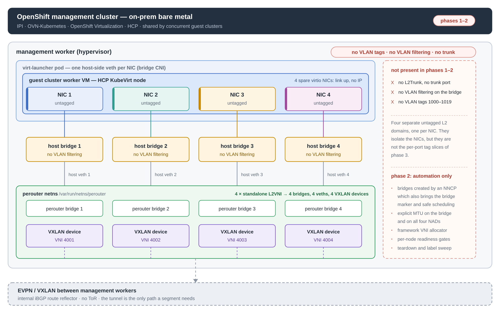
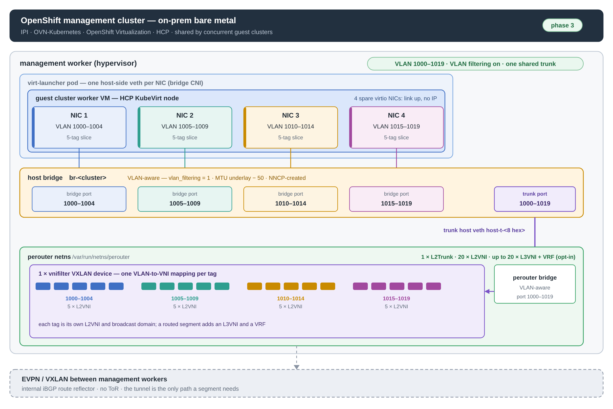

# OpenPERouter for HCP-hosted QE test clusters

**Status:** design in progress (2026-11-13).

**Related:** [L2VNI VLAN trunks](l2vni-vlan-tag.md),
[internal iBGP route reflector](route-reflector.md),
[KubeVirt L2 integration example](../website/content/docs/examples/evpnexamples/kubevirt.md).

## 1. Use case

OpenShift Virtualization QEs validate networking features against guest
clusters that are themselves provisioned through Hosted Control Planes (HCP /
HyperShift) on **on-prem bare metal**:

- **Management cluster:** OpenShift on on-prem bare metal, OVN-Kubernetes,
  OpenShift Virtualization, HCP enabled. It is **shared by several guest
  clusters running concurrently**.
- **Guest cluster (cluster under test):** HCP with the KubeVirt platform
  provider. Its worker nodes are KubeVirt VMs (virt-launcher pods) on the
  management cluster.
- **QE workloads:** run on the guest workers and need **four spare secondary
  NICs per node**, each with real Layer 2 access, link up and no IPv4 address,
  carrying VLAN tags from the fixed range **1000–1019**.

The bare-metal hosts are not attached to a fabric that can deliver those
VLANs: there is no ToR, and the underlay is an internal iBGP route reflector
among the management nodes. OpenPERouter closes that gap by providing
EVPN/VXLAN-backed Layer 2 segments that terminate on host Linux bridges, which
in turn become the guest VM's extra interfaces.

Delivery is phased. OpenPERouter cannot carry VLAN tags until trunk mode is
implemented, so the first phases exercise an **untagged subset** of this use
case and cannot run the VLAN-dependent tests (section 2.1).

### Acceptance

- `network_sanity` must pass in full, **localnet included** — the localnet
  tests are the reason the spare NICs exist.
- SR-IOV, DPDK, PerformanceProfile and Service Mesh suites are out of scope:
  plain KubeVirt VMs provide neither the hardware nor the profiles.
- MTV is a QE requirement but orthogonal — it exercises migration, not these
  NICs, and is owned by another team.

## 2. Platform objectives

1. **Real L2 on the spare NICs without a fabric.** Each guest NIC must behave
   like a switch port on a trunk carrying VLANs 1000–1019.
2. **NIC-level isolation enforced by the platform, not by the guests.** The
   four NICs of a node must not share one broadcast domain. Separation comes
   from per-port VLAN membership on the bridge; no guest cooperation is
   required or assumed.
3. **Internal routing only, when requested.** Routing on a segment is opt-in
   and off by default; when it is enabled, the segment gets its own subnet,
   anycast gateway and VRF, so segments route internally and never to each
   other. There is no external reachability.
4. **Jumbo end to end.** The guest cluster's OVN-K MTU must reach the QE floor
   of **7850**, which is underlay MTU minus VXLAN (50) minus the guest's own
   OVN-K overhead (100).
5. **Declarative, pre-provisioned lifecycle.** The QE framework creates the
   whole dependency set during the guest cluster setup stage, before the
   cluster exists, and tears it down afterwards.
6. **Multi-tenant by construction.** One OpenPERouter instance serves every
   concurrent guest cluster; VNIs, bridges, VRFs and route targets must be
   unique across all of them.
7. **Observable readiness.** The framework confirms per-node convergence from
   status objects and fails the job when the logical infrastructure is not
   there.
8. **Live-migration ready.** Live migration of guest nodes is a basic
   requirement, not an option. Every worker that can host a guest node carries
   the bridge and the whole overlay before the cluster is created, and the
   four NADs pin virt-launcher — source and migration target alike — to nodes
   that advertise the bridge.

### 2.1 Phased design

The platform cannot be delivered in one step, because the VLAN trunk dataplane
does not exist in OpenPERouter yet: the `L2Trunk` API and its validation are
merged, but the dataplane lands with that enhancement. Until then a standalone
`L2VNI` yields exactly one **untagged** L2 domain, so no VLAN tag can be added,
carried or filtered.

Delivery is therefore split into three phases:

1. **Phase 1 — demo today's dataplane.** One bridge and one untagged `L2VNI`
   per NIC, four segments per guest cluster per worker. Proves that the
   existing dataplane reaches the guest NICs and fixes the shape the framework
   will automate. **No VLAN test can run.**
2. **Phase 2 — productize the untagged path for CI.** Same dataplane and the
   same limitation, with the automation around it: NNCP-created bridges, MTU,
   VNI allocation, readiness and teardown. CI can gate untagged L2
   reachability, multi-NIC presence and the MTU chain — and nothing that needs
   a tag.
3. **Phase 3 — trunk mode.** Once the `L2Trunk` dataplane is implemented and
   OpenPERouter is upgraded, the QE framework **re-provisions the environment
   using `L2Trunk`s**: one VLAN-aware bridge and one trunk carrying
   1000–1019, with 20 tagged segments instead of four untagged ones. Only then
   can the full QE suite — the VLAN-range checks and the tagged localnet tests
   — pass.

Two consequences shape the work:

- **Phases 1 and 2 are groundwork, not a preview of the end state.** They
  validate the infrastructure, the CI plumbing and the guest-cluster wiring,
  but they cannot satisfy the QE VLAN requirement and must never be reported
  as doing so.
- **Phase 3 must be a rewrite of the L2 provisioning step, not of the whole
  setup.** Bridge and NAD ownership, the VNI allocator, readiness and teardown
  carry over; what changes is what gets provisioned (trunk instead of
  per-NIC bridges) and how the framework wires it.

Section 5 details each phase, its limitations and the object counts.

## 3. Topology design

This section and the next describe the target design, delivered in phase 3.
Phases 1 and 2 use an interim untagged shape of the same overlay (section 2.1).
The two shapes are drawn below; they differ only in the L2 layer, not in the
EVPN underlay or the guest-cluster wiring.

**Phases 1–2 — four untagged L2 domains, one per NIC**

[](drawings/hcp-qe-phases12-untagged.png)

**Phase 3 — one VLAN-aware bridge, one trunk, per-NIC tag slices**

[](drawings/hcp-qe-phase3-trunk.png)

In both drawings the pod/VM/NIC stack, the host layer and the EVPN underlay
are identical; only the host bridge, the host-side veth and the L2 side of the
router namespace differ. In phases 1–2 each NIC's untagged domain maps to its
own host bridge, its own veth and its own standalone `L2VNI` with a dedicated
VXLAN device. In phase 3 the four NIC ports become VLAN-sliced ports of a
single VLAN-aware bridge, one trunk veth carries all 20 tags into the router
namespace, and a single `vnifilter` VXLAN device holds one VLAN-to-VNI mapping
per tag.

### Segment shape (phase 3): one bridge, one trunk, four NIC slots

Each guest cluster gets **one VLAN-aware host Linux bridge per management
worker** it lands on. The bridge is created by the QE framework through
kubernetes-nmstate, so OpenPERouter attaches to it as an external bridge. A
single `L2Trunk` supplies the bridge with one VXLAN device carrying all 20
tags, backed by 20 `L2VNI`s.

The four NICs are four ports of that same bridge, each confined to its own
VLAN slice:

| Port | VLAN membership |
|------|-----------------|
| NIC 1 | 1000–1004 |
| NIC 2 | 1005–1009 |
| NIC 3 | 1010–1014 |
| NIC 4 | 1015–1019 |
| OpenPERouter trunk | 1000–1019 |

A VLAN ID is a broadcast domain within one bridge, so slicing the ports is
what keeps the NICs isolated while a single trunk remains sufficient. The
trade-off is that each NIC can only use its own five tags: the QE suite must
be configured per job with the slice matching the NIC it runs on. Untagged
traffic is deferred; it would need a distinct native (PVID) tag per port.

The bridge and trunk set is **per guest cluster per management worker**. Two
guest clusters sharing a worker cannot share a bridge — they use the same
tags, so a shared bridge would merge their L2 domains.

### Per-cluster footprint, phase 3 (per management worker)

| Object | Count |
|---|---|
| Host bridges | 1 |
| `L2Trunk` | 1 |
| Trunk host veths | 1 |
| VXLAN devices (L2 side) | 1 |
| `L2VNI` (one per tag) | 20 |
| `L3VNI` (one per `L2VNI`, optional) | 20 |
| VNIs (L2 + L3, one space) | 40 with routing, 20 without |
| VRFs / anycast gateways (optional) | 20 |

Routing on a segment is off by default: the `L3VNI`, VRF and L3 halves of the
VNI rows apply only when the framework asks for a routing domain, and each is
per segment.

### Layer 3: one VRF per segment (optional)

**Routing is opt-in and disabled by default.** A segment is plain L2 unless
its `L2VNI` is given a routing domain. When the QE framework requests one, the
segment gets `gatewayIPs`, its own `L3VNI`, a VRF and an anycast gateway. This
is a parameter the framework may expose in its cluster request API; by
default a segment is created without it, so the optional rows of the table
above and the routing text below apply only to requested segments.

When routing is requested, every routed `L2VNI` is wrapped in its own
`L3VNI`, so the 20 segments become 20 VRFs by construction. No segment can
reach another — not across NIC slots, and not between the five tags of one
slot — so the L3 plane preserves the NIC-level isolation instead of undoing
it. Route targets are unique per segment because they derive from the VNI.

`L3VNI.spec.hostSession` is omitted: gateway traffic never needs to reach the
host's default namespace, which saves 20 host veths and BGP sessions per
cluster per node.

`gatewayIPs` is immutable per `L2VNI`, so the subnet plan must be final at
creation time. One block per concurrent guest cluster, carved into 20 /24s,
with the anycast gateway, the QE dnsmasq instance and the clients inside it.
Blocks should be distinct per cluster: while clusters stay isolated, equal
prefixes in different VRFs never meet, but QE may interconnect guest clusters
later and overlapping subnets would collide at that point.

### Underlay

EVPN runs between the management workers over an **internal iBGP route
reflector**. There is no ToR and no external reachability: the VXLAN tunnel is
the only path a guest segment needs, and nothing leaves the management
cluster. The management network enforces no port security, so VM MACs staying
inside the VXLAN means only the perouter's VTEP MAC is ever visible on the
wire.

### Ownership

| Artifact | Created by | Owns |
|---|---|---|
| NNCP | QE framework, first | the bridge, VLAN filtering enabled, underlay − 50 MTU, on every worker a guest node may migrate to |
| NAD × 4 | QE framework | per-NIC membership: `vlanTrunk` slice + native `vlan` tag + MTU + the bridge-marker `resourceName` |
| `L2Trunk` + 20 `L2VNI`, plus an `L3VNI` per routed segment | QE framework, after the bridge | the trunk veth and the overlay |
| Trunk port membership | QE framework, re-applied NNCP | the trunk veth as a member of 1000–1019 |
| `NodePool.additionalNetworks` | QE framework | references the four NADs |

The per-NIC membership cannot live in the NNCP: the VM's host-side veths are
created by the bridge CNI plugin when each virt-launcher pod starts, after the
NNCP, with plugin-generated names. The NAD is the per-NIC declaration and is
equally deterministic.

## 4. Implementation plan

### Setup sequence

The QE framework drives the guest cluster setup stage in this order. Steps 4
through 6 are ordering requirements, not conventions. Concrete manifests for
every step, in both shapes, are in `hcp-qe-platform-reference-crs.md`.

0. **Platform prerequisites.** Create the `Underlay`s and the guest namespace
   `clusters-<name>`. Every underlay is a `CNIDevice`: a CNI plugin
   (macvlan, static IPAM) provisions the interface inside the router netns and
   the host's own device is never moved, so nothing here uses
   `NetworkDevice`. Because the plugin config embeds that node's own address,
   one object cannot cover several nodes. The reflector is therefore **one
   object per control-plane node** — it runs in the router pod there, not as a
   host process — and the datapath is **one object per worker**. Select each by
   `kubernetes.io/hostname`; the RRs share a `clusterID`, peer with each other
   through explicit `address` neighbors, and every client lists all their
   addresses. The two roles cannot be merged — an RR must not carry a VTEP —
   and no node may match two, because the webhook rejects a second ("can't
   have more than one underlay per node"). That rule is also what keeps the
   set platform-scoped rather than per guest cluster: every guest cluster
   whose VMs land on those workers shares it. DHCP IPAM does not lift the
   per-node requirement: the lease is only stable if the MAC is pinned, and
   the MAC is per node as well. The namespace has to be created here
   because HyperShift only creates it with the `HostedCluster` (step 6), yet
   steps 2 and 3 create NADs and overlay CRs in it and `additionalNetworks`
   must reference NADs from the guest cluster's namespace.
1. **Bridge NNCP.** Create the host bridge VLAN-aware on every worker a guest
   node may run on or migrate to, with an explicit `mtu` of underlay − 50.
   nmstate has no standalone VLAN-filtering switch, so the NNCP declares the
   bridge together with a **dummy port carrying a `vlan` block**; that is what
   makes NetworkManager enable `vlan-filtering` at creation. Keeping the dummy
   keeps filtering on for the life of the bridge, independent of any other
   port's lifecycle.
2. **NADs.** Create four `NetworkAttachmentDefinition`s, one per NIC slot, in
   the HCP namespace `clusters-<name>` (or `default`). Each carries
   `type: bridge`, `bridge: <host bridge>`, `macspoofchk: false`,
   `disableContainerInterface: true`, its own `vlanTrunk` slice, its native
   `vlan` tag, the bridge MTU, and the mandatory
   `k8s.v1.cni.cncf.io/resourceName: bridge.network.kubevirt.io/<bridge>`
   annotation. The native tag stays out of the `vlanTrunk` slice: a tag cannot
   be both native and tagged, and adding it to the slice clears its native
   flags. Interchangeable with step 3.
3. **Overlay CRs.** Create the `L2Trunk` and the 20 `L2VNI`s. For each
   segment the request asks to route, also create its `L3VNI` and set the
   `L2VNI`'s routing domain. OpenPERouter creates the trunk host veth and
   enslaves it to the bridge.
4. **Trunk port membership.** Re-apply the same NNCP with the trunk veth
   added as a bridge port: `mode: trunk`,
   `trunk-tags: [{id-range: {min: 1000, max: 1019}}]`, no `tag`. nmstate can
   only describe a port that already exists, so this must follow step 3; on a
   VLAN-filtering bridge the overlay is dark until it lands. It has to land on
   **every** eligible worker, not just the ones currently hosting VMs, or a
   migrated node arrives at a bridge with no trunk behind it.
5. **NodePool.** Reference the four NADs from
   `NodePool.spec.platform.kubevirt.additionalNetworks`. HyperShift always
   uses bridge binding for these interfaces.
6. **Create the guest cluster** (`HostedCluster` + `NodePool`). The NICs are
   present on each VM at first boot; hot-plug is not needed, and
   `additionalNetworks` cannot be changed afterwards.

One NNCP per bridge, updated in place, keeps the bridge's desired state in a
single object and makes the readiness watch straightforward.

### MTU chain

```
underlay MTU (>= 8000)
  - 50   VXLAN on the management network
  = segment / VM NIC MTU
  - 100  guest cluster's own OVN-K
  = guest cluster MTU (must be >= 7850)
```

The bridge and the four NADs must state the segment MTU explicitly. Nothing
else does: OpenPERouter sets the MTU on the veths it creates inside its own
namespace and never on the external bridge, and the bridge CNI plugin falls
back to the kernel default when the NAD has no `mtu`. A missing MTU caps every
guest cluster at 1500 however large the underlay is. The guest cluster's OVN-K
MTU is set at install and is immutable, so all three values must agree before
a job starts — and the underlay MTU cannot be changed post-install either,
which makes this a platform prerequisite rather than a tuning knob.

### Naming contracts

- **Trunk host veth:** the framework's NNCP addresses this port by name, so
  the name must be derived from the `L2Trunk` name, unique per trunk per node,
  at most 15 characters, and stable across veth recreation (the
  NetworkManager port profile matches by name). `host-t-<8 hex>` fits. The
  trunk path has no naming scheme today; this is the one API obligation the
  design creates.
- **Bridge:** the 15-character limit applies, and because the management
  cluster is shared the names must also be distinct per concurrent guest
  cluster on the same worker. Names must be deterministic from the cluster
  identity.
- **NADs:** four distinct names per NodePool, one interface each.

### Fabric-wide allocation

The QE framework owns a **VNI allocator on the management cluster** and is the
source of truth for every VNI it hands out. It must return VNIs unique across
all guest clusters and all other consumers of the same number space —
`L2VNI` and `L3VNI` share one space. This is a hard precondition:

- FRR derives the automatic EVPN route targets from the VNI alone (import
  `*:<VNI>`, export `(<ASN> & 0xFFFF):<VNI>`), so a collision makes two
  segments import each other's routes and merge.
- OpenPERouter validates uniqueness per node only, so a VNI reused by two
  clusters that never share a hypervisor passes validation and fails silently
  in BGP.
- Global uniqueness is what would let the guest clusters be interconnected
  later; a collision then becomes an immediate failure rather than a latent
  isolation bug.

A cluster-prefixed block per guest cluster is the simplest allocator design
that satisfies this. A cheap defence on the OpenPERouter side is to also
validate VNI uniqueness cluster-wide, across all namespaces and nodes.

### Readiness

The framework confirms infrastructure per node from both controllers and
**errors out** if it is not converged:

- kubernetes-nmstate: NNCP `Available` plus the per-node enactments.
- OpenPERouter: `RouterNodeConfigurationStatus` named after the node, with
  `Ready=True`, `Degraded=False` and an empty `failedResources`.
- The bridge is VLAN-aware:
  `cat /sys/class/net/<br>/bridge/vlan_filtering` is `1` on every node.

The filtering check is not optional: `br_vlan_add()` has no filtering gate, so
if filtering ever turns off, the stored memberships go inert, all 20 tags
flood between the four NICs, traffic keeps working through the perouter, and
nothing reports a difference.

### Scheduling and live migration

Live migration is a basic requirement, so the four NADs carry the
`k8s.v1.cni.cncf.io/resourceName: bridge.network.kubevirt.io/<bridge>`
annotation. The bridge marker, which ships with OpenShift Virtualization and
needs nothing deployed for this, publishes that name as a per-node extended
resource for every node where the bridge exists; virt-launcher requests it, so
KubeVirt schedules the source pod **and** the migration target only onto those
nodes. Without the annotation a running VM can be migrated to a worker with no
bridge and lose its four NICs.

The annotation covers the bridge alone. The trunk, its port membership and the
20 segments must already be reconciled on every eligible worker — the dataplane
does not follow the VM — which is why step 4 is a per-worker requirement and not
a one-off on the busy nodes. Migration availability is gated on per-node
readiness for all eligible workers (section *Readiness*), not only for the ones
currently hosting VMs.

### Teardown

Owned by the framework, in reverse order:

1. Delete `HostedCluster`/`NodePool` and wait for the virt-launcher pods to
   go — deleting a bridge while VMs still run cuts their NICs.
2. Delete the OpenPERouter CRs and the NADs. If they live in the HCP namespace
   `clusters-<name>`, deleting the namespace removes both together.
3. Delete the bridge NNCP, which removes the bridge, the dummy port and the
   trunk port membership.
4. Verify `RouterNodeConfigurationStatus` reports no `failedResources`.

Every framework-created object carries a `cnv-qe/cluster=<id>` label so the
next job can sweep a failed run's leftovers. A stale `L2Trunk` is the object
that leaks a veth and a bridge port.

## 5. Phased delivery

Section 2.1 summarizes the three phases and why the missing VLAN dataplane
forces them. This section details what each phase delivers, what it cannot,
and how the object counts move between them.

The shared VXLAN device is part of the trunk model, not the underlay. An
`L2Trunk` owns a single `external vnifilter` VXLAN device that all of its
`L2VNI`s share, one VLAN-to-VNI mapping each. The `Underlay` provides only the
VTEP — the `vtep-lo` loopback and its address. Today each standalone `L2VNI`
creates its own bridge, veth pair and VXLAN device inside the router
namespace, so four untagged segments mean four VXLAN devices.

### Phase 1 — demo on today's dataplane

**Goal:** prove that the existing standalone `L2VNI` dataplane reaches the
guest NICs, and establish the shape the QE framework will automate.

**Shape:** one bridge and one standalone `L2VNI` per NIC, so four bridges and
four segments per guest cluster per worker. Routing is off by default; the demo
may wrap a segment in its own `L3VNI` when the scenario needs a gateway.
Bridges may be OpenPERouter-managed (`br-hs-<VNI>`) or NNCP-created and
external. One guest cluster, set up by hand.

**Limitations — none of these can be closed in this phase:**

- **No VLAN support at all.** No `L2Trunk`, no `vlanTrunk`, no VLAN filtering,
  no tagging. Every segment is untagged, and nothing in the QE range
  1000–1019 is exercised — the range does not exist on this path.
- **Any test that assigns a VLAN ID fails.** That covers the VLAN-range
  checks and every localnet test configured with a tag, so `network_sanity`
  cannot pass in full.
- **NIC-level isolation is approximate.** Four separate bridges happen to
  isolate the four NICs, but they are four independent untagged domains, not
  the per-port slices of the target design. There is no per-NIC tag range.
- **No fabric-wide allocation.** VNIs are hand-picked; only a single demo
  cluster is safe.
- **MTU, readiness and teardown are manual.** Scheduling and live migration
  are unsafe by construction: the bridges are hand-built on the nodes in use,
  so only those nodes have one, and nothing checks that the overlay is ready on
  a node before a VM lands there. Phase 2 closes this by creating the bridge
  with an NNCP and shipping the four NADs with the bridge-marker annotation.

### Phase 2 — productify the untagged dataplane for CI

**Goal:** run the phase 1 dataplane repeatably in the QE CI environment, with
the same limitations and no VLAN claims.

**Shape:** unchanged — four untagged segments per guest cluster per worker,
one bridge per NIC. What is added is the automation around it: NNCP-created
external bridges (which also brings the bridge marker and safe scheduling),
explicit MTU on the bridge and all four NADs, the framework's VNI allocator,
the per-node readiness gates, and the teardown and label sweep. Four bridge
names per cluster per worker must fit the 15-character limit here, a cost
phase 3 gives back when it returns to one bridge.

**Limitations — identical to phase 1, and they are the reason this is not the
final state:**

- **No VLAN support.** CI can gate untagged L2 reachability, multi-NIC
  presence (link up, no IPv4) and the MTU chain, and nothing else. It must
  report the VLAN-range and tagged-localnet checks as **not covered**, never
  as passing.
- **Four segments, not twenty.** Where routing is requested, the subnet plan
  covers four /24s and has to be redone for phase 3. Neither footprint ships
  routing by default: the per-segment `L3VNI` stays opt-in in both.
- **No trunk, so no VLAN-aware bridge.** The NNCP is the simple form: no
  dummy port, no filtering, no per-port membership, and the overlay is never
  dark waiting for a trunk port.

Framework code that survives into phase 3: bridge and NAD ownership, the VNI
allocator, readiness, and teardown. What phase 3 rewrites is the L2 wiring —
one bridge instead of four, one trunk instead of four veths, twenty segments
instead of four, and `vlanTrunk` in the NADs.

### Phase 3 — trunk mode

**Gated on:** the `L2Trunk` dataplane landing and a deterministic trunk host
veth name, since the framework's NNCP addresses that port by name.
Cluster-wide VNI validation would be worth landing alongside it, but the
framework's allocator already enforces the requirement.

**Change:** upgrade OpenPERouter, replace the four untagged bridges and
`L2VNI`s with the target design of section 3 — one VLAN-aware bridge, one
trunk carrying 1000–1019, and 20 `L2VNI`s, with an `L3VNI` added only for the
segments a request marks as routed — and rewrite the framework setup to the
six-step sequence of section 4. The four NADs switch to `vlanTrunk` slices and
gain native tags. Only then do the VLAN-range checks and the tagged localnet
tests become achievable.

### Shape comparison

| Per guest cluster per worker | Phases 1–2 | Phase 3 |
|---|---|---|
| Host bridges | 4 | 1 |
| `L2Trunk` | — | 1 |
| Host veths from OpenPERouter | 4 | 1 |
| VXLAN devices for the L2 segments | 4 (one per `L2VNI`) | 1 (shared `vnifilter`) |
| `L2VNI` | 4 | 20 |
| `L3VNI` (optional, per routed segment) | 4 | 20 |
| VLAN tags exercised | none | 1000–1019 |
| VLAN filtering | not needed | required |
| NIC isolation | one bridge per NIC | per-port tag slice |

Each routed segment keeps its own `L3VNI` bridge and VXLAN device in both
phases, so the rows above count the L2 side only. The `L3VNI` row is the
maximum when every segment is routed; with routing off — the default — it is
zero.

## 6. Failure modes to guard

| Failure | Symptom | Guard |
|---|---|---|
| Filtering off | All 20 tags flood between the four NICs; traffic still works, nothing reports it | Per-node `vlan_filtering` check in readiness; keep the dummy port |
| Trunk port membership missing | Overlay dark while `L2VNI`s exist and nodes are `Ready` | Step 4 must complete before the NodePool boots; readiness gates on dataplane, not object existence |
| Shared native VLAN 1 | Untagged frames flood between the four NICs | Distinct native `vlan` per port (CNI plugins ≥ v1.8.0), or accept tagged-only isolation |
| VNI collision across clusters | Two segments merge in BGP, silently | Fabric-wide allocator; cluster-wide validation on the OpenPERouter side |
| Missing MTU | Guest cluster capped at 1500, OVN-K below the QE floor, immutable after install | Explicit MTU in the NNCP and all four NADs; MTU check at setup |
| NNCP port pruning | Re-applying the bridge drops CNI-created ports | `bridge.allow-extra-ports: true` on every apply (it is not persisted); validate the field on the target OCP first |
| NNCP re-apply on node join | New worker never gets its trunk membership; policy fails until re-applied | Framework re-runs both NNCP phases per new node |
| MAC spoofing disabled | `macspoofchk: false` on these segments | Acceptable for isolated QE; document as a security trade-off |
| Slice mismatch | A tag outside a NIC's slice is dropped at ingress | Configure each job with the slice matching its NIC |
| Migration onto an unprepared worker | The guest node moves to a worker with no bridge, or with a bridge and no trunk, and its four NICs come up with no dataplane | Mandatory `resourceName` annotation on all four NADs (the bridge marker ships with OpenShift Virtualization) **and** per-node readiness on every worker a guest node may reach, not only on the busy ones |

## 7. Open items

- **Concurrency and placement.** How many concurrent guest clusters per
  management worker, and whether the OpenPERouter CRs live in the HCP
  namespace `clusters-<name>` (natural teardown unit) or in the shared
  `openperouter-system`. The router controller watches cluster-wide, so both
  work; the `Underlay` set (one RR object per control-plane node, one datapath
  object per worker) is platform-scoped and belongs in `openperouter-system`
  either way.
- **Underlay MTU.** The exact smallest MTU on the path between hypervisors
  (jumbo is expected but short of 9000); anything below 8000 fails the QE
  floor.
- **Scale target.** With M concurrent clusters per worker, one FRR process,
  one perouter namespace and one bridge carry 20×M `L2VNI`s, plus 20×M
  `L3VNI`s and VRFs if every segment is routed. Needs a target and a
  measurement of FRR config size and convergence time.
- **Versions.** Target OCP / HCP / Virt versions, and the
  `containernetworking-plugins` version on the target nodes: the VLAN slicing
  design needs `vlanTrunk` (≥ v1.5.0) and `vlan` + `vlanTrunk` together
  (≥ v1.8.0) to avoid a shared native VLAN.
- **Subnet plan.** Address family, addresses per segment, and whether an
  existing QE-wide plan must be respected.
- **Guest side.** Whether the guest cluster must be configured to never
  assign an IP to the spare NICs. OpenPERouter stops at the hypervisor.
