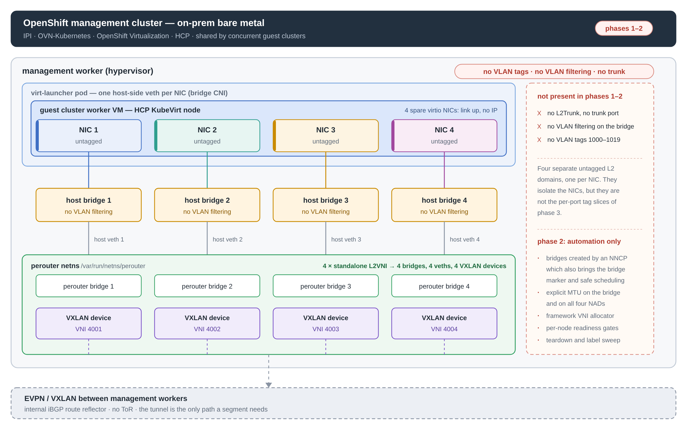
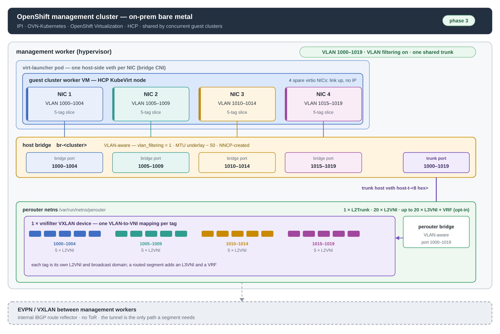

# OpenPERouter for HCP-hosted QE test clusters

**Status:** design in progress (2026-11-13; revised 2026-11-17 for the shared
platform overlay).

**Related:** [L2VNI VLAN trunks](l2vni-vlan-tag.md),
[internal iBGP route reflector](route-reflector.md),
[KubeVirt L2 integration example](../website/content/docs/examples/evpnexamples/kubevirt.md).
Concrete manifests for every step: [reference CRs](hcp-qe-platform-reference-crs.md).

## 1. Use case

OpenShift Virtualization QEs validate networking features against guest
clusters provisioned through Hosted Control Planes (HCP / HyperShift) on
**on-prem bare metal**:

- **Management cluster:** OpenShift on on-prem bare metal, OVN-Kubernetes,
  OpenShift Virtualization, HCP enabled. It is **shared by several guest
  clusters running concurrently**.
- **Guest cluster (cluster under test):** HCP with the KubeVirt platform
  provider. Its worker nodes are KubeVirt VMs (virt-launcher pods) on the
  management cluster.
- **QE workloads:** run on the guest workers and need **four spare secondary
  NICs per node**, each with real Layer 2 access, link up and no IPv4 address,
  carrying VLAN tags from the fixed range **1000–1019**.

The bare-metal hosts are not attached to a fabric that can deliver those
VLANs: there is no ToR, and the underlay is an internal iBGP route reflector
among the management nodes. OpenPERouter closes that gap with EVPN/VXLAN-backed
Layer 2 segments that terminate on host Linux bridges, which become the guest
VM's extra interfaces.

The overlay is **platform-scoped**: the admin creates it once — the segments,
bridges, and the four NADs in `default` — and every guest cluster consumes the
same segments and the same NADs, so clusters are connected to each other per
VLAN tag and per-cluster isolation is deferred. Delivery is phased: until trunk
mode lands, phases 1–2 exercise only an untagged subset and cannot run the
VLAN-dependent tests (section 5).

### Acceptance

- `network_sanity` must pass in full, **localnet included** — the localnet
  tests are the reason the spare NICs exist.
- SR-IOV, DPDK, PerformanceProfile and Service Mesh suites are out of scope:
  plain KubeVirt VMs provide neither the hardware nor the profiles.
- MTV is a QE requirement but orthogonal — it exercises migration, not these
  NICs, and is owned by another team.

## 2. Platform objectives

1. **Real L2 on the spare NICs without a fabric.** Each guest NIC behaves like
   a switch port on a trunk carrying VLANs 1000–1019.
2. **NIC-level isolation enforced by the platform, not by the guests.** The
   four NICs of a node must not share one broadcast domain; separation comes
   from per-port VLAN membership on the bridge, and no guest cooperation is
   required or assumed. This isolation is within a node: different guest
   clusters deliberately share each segment.
3. **L2 only in the initial delivery.** Segments are plain L2; internal
   routing (subnet, anycast gateway and VRF per segment) is deferred.
4. **Jumbo on two independent MTU paths.** The spare NICs are plain Ethernet
   over one VXLAN hop, so the guest gets the segment MTU (underlay − 50) on
   them. The guest OVN MTU does not come from there: `attachDefaultNetwork:
   true` keeps the primary NIC on the management pod network, which sets it.
   Each path has its own cross-worker, no-fragmentation gate (section 4).
5. **One shared overlay, cluster-scoped wiring.** The admin provisions the
   overlay and the four NADs once and every guest cluster shares them. Per
   cluster, the framework creates only the `HostedCluster` and `NodePool`, and
   removes them afterwards.
6. **Observable readiness.** The framework confirms per-node convergence from
   status objects before wiring a cluster and fails the job otherwise.
7. **Live-migration ready.** Every worker that can host a guest node carries
   the bridge and the whole overlay before the cluster is created, and the
   four NADs pin virt-launcher — source and migration target alike — to nodes
   that advertise the bridge.

The `L2Trunk` API and its validation are merged, but its dataplane is not.
Until it lands, a standalone `L2VNI` yields exactly one **untagged** L2 domain,
so no VLAN tag can be added, carried or filtered. Phases 1–2 are groundwork
that cannot satisfy the QE VLAN requirement and must never be reported as
doing so.

## 3. Topology design

This section describes the target design, delivered in phase 3. Phases 1–2 use
an interim untagged shape of the same overlay (section 5); the two differ only
in the L2 layer, not in the EVPN underlay or the guest-cluster wiring.

**Phases 1–2 — four shared untagged L2 domains, one per NIC**

[](drawings/hcp-qe-phases12-untagged.png)

**Phase 3 — one shared VLAN-aware bridge, one trunk, per-NIC tag slices**

[](drawings/hcp-qe-phase3-trunk.png)

In phases 1–2 each NIC's untagged domain maps to its own host bridge, veth and
standalone `L2VNI` with a dedicated VXLAN device. In phase 3 the four NIC ports
become VLAN-sliced ports of one VLAN-aware bridge, one trunk veth carries all
20 tags into the router namespace, and a single `vnifilter` VXLAN device holds
one VLAN-to-VNI mapping per tag. Both shapes are platform-scoped.

### Segment shape (phase 3): one shared bridge, one trunk, four NIC slots

The platform has **one VLAN-aware host Linux bridge per management worker**,
named for the platform (for example `br-qe`). The admin creates it through
kubernetes-nmstate, so OpenPERouter attaches as an external bridge. One
`L2Trunk` supplies it with a single VXLAN device carrying all 20 tags, backed
by 20 `L2VNI`s.

The four NICs are ports of that bridge, each confined to its own VLAN slice:

| Port | VLAN membership |
|------|-----------------|
| NIC 1 | 1000–1004 |
| NIC 2 | 1005–1009 |
| NIC 3 | 1010–1014 |
| NIC 4 | 1015–1019 |
| OpenPERouter trunk | 1000–1019 |

A VLAN ID is a broadcast domain within one bridge, so slicing the ports keeps
the four NICs of a node isolated while one trunk suffices. Each NIC can use
only its five tags, so a QE job must be configured with the slice matching its
NIC; untagged traffic is deferred and would need a distinct native (PVID) tag
per port. **The same tag is shared by every guest cluster** — cluster A's NIC 1
and cluster B's NIC 1 land in the same domain — so there is no cross-cluster
isolation at this stage; the slices only keep a node's NICs apart.

### Footprint, phase 3

| Object | Scope | Count |
|---|---|---|
| Host bridge | platform, per worker | 1 |
| `L2Trunk` | platform, per worker | 1 |
| Trunk host veth | platform, per worker | 1 |
| VXLAN device (L2 side) | platform, per worker | 1 |
| `L2VNI` (one per tag) | platform, per worker | 20 |
| VNI | platform, per worker | 20 |
| Namespace | per guest cluster | 1 |
| NAD (in `default`) | platform | 4 |
| `NodePool.additionalNetworks` entry | per guest cluster | 4 |

The framework creates no overlay object: no `L2VNI`, `L2Trunk`, VXLAN device,
bridge or NAD is per guest cluster. Routing is not part of the initial delivery, so no
`L3VNI`, VRF or anycast gateway is provisioned. If it is added later, each
routed segment needs its own `L3VNI` and VRF, shared by all clusters on that
tag: one subnet and one gateway per tag.

### Underlay

EVPN runs between the management workers over an **internal iBGP route
reflector**. There is no ToR and no external reachability: the VXLAN tunnel is
the only path a guest segment needs. The management network enforces no port
security, so with VM MACs kept inside the VXLAN only the perouter's VTEP MAC is
visible on the wire.

One VXLAN hop is the only encapsulation on the spare-NIC path, so the segment
MTU is underlay − 50. The guest's own OVN-K Geneve traffic rides the management
pod network instead (section 4).

### Ownership

Everything that exists once per platform belongs to the **admin**; everything
per guest cluster belongs to the **framework**. The split lets the framework
run with cluster-scoped rights against a prepared platform.

| Artifact | Created by | Owns |
|---|---|---|
| `Underlay`s | admin, once | one RR object per control-plane node and one datapath object per worker |
| NNCP | admin, once | the shared bridge, VLAN filtering enabled, the spare-NIC segment MTU (underlay − 50), on every worker a guest node may migrate to |
| `L2Trunk` + 20 `L2VNI` | admin, once | the overlay every cluster uses |
| Trunk veth and VLAN membership | OpenPERouter, from the `L2Trunk` | creates and enslaves the trunk veth and programs it as a member of 1000–1019; the NNCP never names it |
| NAD × 4 in `default` | admin, once | per-NIC membership: `vlanTrunk` slice + native `vlan` tag + MTU + the bridge-marker `resourceName` |
| Namespace `clusters-<name>` | HyperShift, with the `HostedCluster` | the guest cluster's HCP namespace |
| `NodePool.additionalNetworks` | framework | references the four platform NADs |

The per-NIC membership cannot live in the NNCP: the VM's host-side veths are
created by the bridge CNI plugin when each virt-launcher pod starts, after the
NNCP, with plugin-generated names. The NAD is the per-NIC declaration and is
equally deterministic. It is also platform state: the four NADs are created
once in `default`, which Multus resolves from any namespace, and every guest
cluster references `default/nic<n>`. Only the overlay owner can change a tag
slice or the NIC MTU, and doing so affects every cluster at once.

## 4. Implementation plan

We are only showing the setup sequence for phase 3, which allows for vlan aware
bridges, and thus allows for supporting tests with VLANs.

The exact manifests used for phase 2 are listed in: [phases 1–2 — four shared untagged bridges](hcp-qe-platform-reference-crs.md#phases-12--four-shared-untagged-bridges)

The exact manifests used for phase 3 are listed in: [phase 3 — shared VLAN-aware bridge and trunk](hcp-qe-platform-reference-crs.md#phase-3--shared-vlan-aware-bridge-and-trunk)

For clarity, the starpup sequence for phase 3 is described below.

### Setup sequence (phase 3)

The work splits in two: the **platform overlay**, created once by the admin
and shared by every guest cluster, and the **guest-cluster wiring**, repeated
per cluster by the framework. There is no NNCP re-apply: OpenPERouter derives
the trunk veth and its VLAN membership from the `L2Trunk`, so clusters can be
wired concurrently once the overlay is ready. Concrete manifests for every
step, in both shapes, are
in [the reference CRs](hcp-qe-platform-reference-crs.md).

#### Platform setup (admin, once)

- P0. **Underlays.** One `CNIDevice` per node, selected by
   `kubernetes.io/hostname`: one RR object per control-plane node (it runs in
   the router pod there) and one datapath object per worker. The macvlan plugin
   with static IPAM creates the interface inside the router netns, so no host
   device moves (nothing here uses `NetworkDevice`); because the address is
   embedded in the plugin config, one object cannot cover several nodes. An RR
   must not carry a VTEP, and no node may match two. The RRs share a
   `clusterID`, peer through explicit `address` neighbors, and every client
   lists all their addresses; DHCP does not lift the per-node requirement
   without a pinned per-node MAC.
- P1. **Bridge NNCP.** Create the shared host bridge VLAN-aware on every worker
   a guest node may run on or migrate to, with an explicit `mtu` of underlay
   − 50. nmstate has no standalone VLAN-filtering switch, so the NNCP declares
   the bridge with a **dummy port carrying a `vlan` block** (an access port on
   an unused VLAN); that makes NetworkManager enable `vlan-filtering` at
   creation, and keeping the dummy keeps it on for the bridge's life. The dummy
   is not a trunk port and is not a member of 1000–1019; OpenPERouter programs
   the trunk membership. No `allow-extra-ports` is needed: OCP
   marks every `veth` device unmanaged in NetworkManager (`driver:veth` in
   `/etc/NetworkManager/conf.d/sdn.conf`), so nmstate treats the CNI-created
   bridge ports as ignored and excludes them from the diff instead of pruning
   them.
- P2. **Overlay CRs.** Create the `L2Trunk` and the 20 `L2VNI`s in the
   OpenPERouter namespace, `openshift-openperouter`. Cross-object references
   such as `L2VNI.spec.trunk.name` are same-namespace only, so the trunk
   belongs there too. OpenPERouter creates the trunk host veth, enslaves it to
   the bridge and programs its VLAN membership (1000–1019) from the `L2Trunk`.
   The bridge NNCP never lists the trunk port, so no companion NNCP apply is
   needed and VLAN membership is reconciled with the rest of the overlay.
- P3. **NADs.** Create the four `NetworkAttachmentDefinition`s, one per NIC
   slot, in `default`. Each carries `type: bridge`, `bridge: <shared host
   bridge>`, `macspoofchk: false`, `disableContainerInterface: true`, its own
   `vlanTrunk` slice, its native `vlan` tag, the bridge MTU, and the mandatory
   `k8s.v1.cni.cncf.io/resourceName: bridge.network.kubevirt.io/<bridge>`
   annotation. The native tag stays out of `vlanTrunk`: a tag cannot be both
   native and tagged, and adding it to the slice clears its native flags.

#### Per-cluster setup (QE framework)

- C1. **HostedCluster + NodePool.** Apply both objects. HyperShift creates
   `clusters-<name>`; no per-cluster namespace or NAD has to exist beforehand.
   `NodePool.spec.platform.kubevirt.additionalNetworks` lists
   `default/nic1`–`default/nic4` (HyperShift always uses bridge binding), and
   cannot be changed afterwards. The NICs are present on each VM at first boot,
   so hot-plug is not needed.

The framework never creates, updates or deletes the bridge, the trunk, the
segments or the NADs; it only reads them to verify a cluster. It writes only
`HostedCluster` and `NodePool`, so it needs no write access to
`openshift-openperouter` or to `default`. One platform NNCP keeps the bridge's
desired state in a single object; the trunk side needs no NNCP change.

### MTU paths and their gates

Two independent paths, neither derivable from the other:

```
Path A - guest OVN (pod-to-pod inside the guest)
management underlay MTU (>= 8050)
  - 100  management OVN-K Geneve (the virt-launcher pod network)
  = management pod network MTU = guest worker primary NIC MTU
  - 100  guest OVN-K Geneve
  = guest OVN MTU                    (QE floor: >= 7850)

Path B - spare NICs (L2 between guest nodes)
underlay MTU (>= 8000)
  - 50   VXLAN between management workers
  = segment MTU = guest-visible NIC MTU   (nothing encapsulates on top)
```

`attachDefaultNetwork: true` keeps the guest worker's primary NIC on the
management pod network, so the guest's Geneve tunnels never touch the four
spare NICs: a 7950-byte NAD establishes nothing about the guest OVN MTU, and
7850 needs a management pod network of 7950 (8050 of underlay), immutable at
management cluster install. A jumbo guest primary NIC would mean dropping the
default network, out of scope here.

Path B needs the segment MTU stated explicitly in the bridge NNCP and all four
NADs: OpenPERouter only sets the MTU on the veths inside its namespace, never
on the external bridge, and the bridge CNI plugin falls back to the kernel
default when a NAD has no `mtu`, capping the NICs at 1500 however large the
underlay is.

Both paths are gated by a cross-worker, no-fragmentation test: endpoints on VMs
whose virt-launcher pods run on different management workers, DF set (a
fragmented packet still arrives and would hide a too-small hop), MTU read from
the interface rather than the manifest, and failure fails the job. The guest
OVN gate is also the only way to catch an undersized management pod network —
no NAD or NNCP inspection reveals it.

| Gate | Placement | Pass condition |
|---|---|---|
| Guest OVN | one pod on each of two guest workers, same guest namespace | `ping -M do -s $((MTU-28))` passes; `-s $((MTU-27))` fails |
| Spare NIC | one interface per guest worker, same tag (within one slice in phase 3) | `ping -I <dev> -M do -s $((MTU-28))` passes; one byte more fails |

Path A runs once per management cluster, path B per job.

### Naming contracts

- **Trunk host veth:** derived by OpenPERouter from the `L2Trunk` name, unique
  per trunk per node and at most 15 characters; `host-t-<8 hex>` fits. It is
  an OpenPERouter implementation detail, not a platform contract: the NNCP
  never names the trunk port, so no external object has to track the name.
- **Bridge:** one platform bridge, so `br-qe` fits the 15-character limit; no
  per-cluster naming budget.
- **NADs:** one set of four in `default`, one interface each; the names must be
  unique only there, and every `NodePool` references the same
  `default/nic<n>`.

### Fabric-wide allocation

The overlay is platform-scoped, so there is exactly **one** set of VNIs and no
per-cluster allocator: the admin picks a block unique on the management
cluster and uses it for the single `L2Trunk` (20 VNIs without routing; `L2VNI`
and `L3VNI` would share one space). If per-cluster overlays return, VNI
collisions merge segments in BGP silently, because FRR derives route targets
from the VNI alone and OpenPERouter validates uniqueness per node only; a
cluster-wide uniqueness check is the cheap backstop.

### Readiness

Before wiring any guest cluster, the framework confirms the platform overlay
per node from both controllers and **errors out** if it is not converged:

- kubernetes-nmstate: NNCP `Available` plus the per-node enactments.
- OpenPERouter: `RouterNodeConfigurationStatus` named after the node, with
  `Ready=True`, `Degraded=False` and an empty `failedResources`.
- The bridge is VLAN-aware: `/sys/class/net/<br>/bridge/vlan_filtering` is 1.
- The four platform NADs exist in `default`, point at the bridge and carry the
  expected MTU and tag slices. The framework never edits them, but a missing or
  drifted NAD breaks every cluster at once, so it is checked before wiring.

The check covers the shared overlay, so it runs once per platform and is
re-checked on node join and after an upgrade, but it must cover every eligible
worker because live migration depends on the dataplane there. The filtering
check is mandatory: `br_vlan_add()` has no filtering gate, so if filtering
turns off the stored memberships go inert and all 20 tags flood between the
NICs while traffic still works and nothing reports a difference.

Readiness certifies objects and dataplane, not path MTU: the two gates above
are the pre-job MTU check.

### Scheduling and live migration

The four NADs carry the
`k8s.v1.cni.cncf.io/resourceName: bridge.network.kubevirt.io/<bridge>`
annotation. The bridge marker (shipped with OpenShift Virtualization) publishes
that name as a per-node extended resource wherever the bridge exists, and
virt-launcher requests it, so KubeVirt schedules the source pod and the
migration target only onto prepared nodes. Without it a VM can migrate to a
worker with no bridge and lose its four NICs.

### Teardown

The per-cluster teardown is the framework's and touches no shared object; the
platform teardown is the admin's.

**Per cluster (framework), in reverse order:**

1. Delete `HostedCluster`/`NodePool` and wait for the virt-launcher pods to
   go — a VM must not outlive its NIC wiring.
2. Delete the namespace `clusters-<name>`, which HyperShift leaves behind.

No `L2VNI`, `L2Trunk`, bridge or NAD is deleted: they belong to the platform
and are still in use by other clusters.

**Platform (admin), only when no guest cluster uses the overlay:**

1. Delete the four NADs in `default`.
2. Delete the `L2VNI`s and the `L2Trunk`.
3. Delete the bridge NNCP, which removes the bridge and the dummy port. The
   trunk veth and its VLAN membership went with the `L2Trunk`.
4. Verify `RouterNodeConfigurationStatus` reports no `failedResources`.

Every framework-created object carries a `cnv-qe/cluster=<id>` label so the
next job can sweep a failed run's leftovers. A failed run leaks only its own
namespace and cluster; the overlay and the NADs are not per-job state, and
their blast radius is platform-wide, so platform changes and teardown must be
coordinated.

## 5. Phased delivery

In every phase the overlay is platform-scoped, so no count multiplies with the
number of clusters.

The shared VXLAN device is part of the trunk model, not the underlay: an
`L2Trunk` owns one `external vnifilter` VXLAN device shared by all its
`L2VNI`s, while the `Underlay` provides only the VTEP loopback and address.
Today each standalone `L2VNI` creates its own bridge, veth pair and VXLAN
device, so four untagged segments mean four VXLAN devices.

### Phase 1 — demo on today's dataplane

**Goal:** prove the existing standalone `L2VNI` dataplane reaches the guest
NICs and establish the shape the platform will automate. **Shape:** one bridge
and one standalone `L2VNI` per NIC, so four bridges and four segments per
management worker, shared by every guest cluster; one cluster, set up by hand.
Bridges may be OpenPERouter-managed (`br-hs-<VNI>`) or NNCP-created and
external.

**Limitations:** no VLAN support at all, so any test that assigns a VLAN ID
fails and `network_sanity` cannot pass in full; NIC isolation is only
approximate (four independent untagged domains, no per-NIC tag range);
clusters are not isolated by design; MTU, readiness and the overlay lifecycle
are manual, and live migration is unsafe because only the hand-built nodes have
a bridge.

### Phase 2 — productify the untagged dataplane for CI

**Goal:** run the phase 1 dataplane repeatably in CI, with the same limitations
and no VLAN claims. The admin automates the underlays, bridges, MTU, the
platform VNI block, readiness and the platform lifecycle, plus the four
platform NADs; the framework automates the `HostedCluster` and `NodePool`.
CI can gate untagged
L2 reachability, multi-NIC presence and both MTU gates, and must report the
VLAN-range and tagged-localnet checks as **not covered**. There are four
segments rather than twenty, and the simple NNCP has no dummy port, filtering,
per-port membership or dark-waiting trunk.

### Phase 3 — trunk mode

**Gated on** the `L2Trunk` dataplane landing, including OpenPERouter's
programming of the trunk veth and its VLAN membership. The admin replaces the
four untagged bridges and `L2VNI`s with the target
design of section 3 (one shared VLAN-aware bridge, one trunk carrying
1000–1019, 20 `L2VNI`s, and the four NADs rewritten with `vlanTrunk` slices and
native tags). Every per-cluster object is untouched: the `NodePool` keeps
referencing `default/nic<n>`, so a new cluster picks up the new shape and an
existing one follows it without a rewrite. Only then do the VLAN-range checks
and tagged localnet tests become achievable; the spare-NIC MTU gate then runs
on a tag, while the guest OVN gate is unaffected by the phases.

### Shape comparison

| Per platform per worker | Phases 1–2 | Phase 3 |
|---|---|---|
| Host bridges | 4 | 1 |
| `L2Trunk` | — | 1 |
| Host veths from OpenPERouter | 4 | 1 |
| VXLAN devices for the L2 segments | 4 (one per `L2VNI`) | 1 (shared `vnifilter`) |
| `L2VNI` | 4 | 20 |
| VLAN tags exercised | none | 1000–1019 |
| VLAN filtering | not needed | required |
| NIC isolation | one bridge per NIC | per-port tag slice |

Per guest cluster the footprint is the same in both shapes: one namespace, four
`additionalNetworks` entries and no platform objects. The four NADs are part of
the platform footprint and do not multiply with the number of clusters.

Routing is not provisioned in either phase; an `L3VNI` would add a bridge and
VXLAN device per routed segment. None of the overlay rows multiply with the
number of concurrent guest clusters.

## 6. Failure modes to guard

| Failure | Symptom | Guard |
|---|---|---|
| Filtering off | All 20 tags flood between the four NICs; traffic still works, nothing reports it | Per-node `vlan_filtering` check in readiness; keep the dummy port |
| Trunk veth or VLAN membership missing | Overlay dark **for every cluster** while `L2VNI`s exist and nodes are `Ready` | OpenPERouter configures both from the `L2Trunk`; readiness gates on the per-node dataplane, not object existence |
| Shared native VLAN 1 | Untagged frames flood between the four NICs | Distinct native `vlan` per port (CNI plugins ≥ v1.9.0, confirmed), or accept tagged-only isolation |
| Shared segment exposure | Any cluster's VM on a tag reaches every other cluster's VMs on it; broadcast noise, stray DHCP/ARP and MAC collisions cross job boundaries, and any cluster can spoof | Accepted for this stage; document it, keep each job's dnsmasq scoped to its own clients, and add the per-cluster API before results depend on a quiet segment |
| Platform overlay outage | One bad NNCP, trunk or bridge change blacks out every concurrent job | Overlay changes are admin-only and outside the per-job path; re-run the readiness gate after any change |
| NAD drift | A job or a stray edit changes a tag slice or the MTU on a shared NAD, silently affecting every cluster | NADs are admin-owned and read-only for the framework; readiness re-checks their MTU and slices before wiring |
| Missing MTU on the spare NICs | Guest-visible NIC MTU falls back to 1500; jumbo localnet tests fail while the guest OVN path looks fine | Explicit `mtu` in the bridge NNCP and all four NADs; per-job tagged-NIC no-fragmentation gate |
| Guest OVN MTU below the QE floor | It follows the management pod network MTU, not the NIC MTU, so jumbo NICs do not help; immutable after guest install | Guest OVN no-fragmentation gate before the job; management pod network at 7950 |
| NNCP apply on node join | New worker never gets its bridge; policy fails until re-applied | Admin re-runs P1 per new node; OpenPERouter converges the trunk on that node independently |
| Slice mismatch | A tag outside a NIC's slice is dropped at ingress | Configure each job with the slice matching its NIC |
| Migration onto an unprepared worker | The guest node moves to a worker with no bridge, or with a bridge and no trunk, and its four NICs come up with no dataplane | Mandatory `resourceName` annotation on all four NADs **and** per-node readiness on every worker a guest node may reach |

## 7. Open items

- **Concurrency and scale.** How many concurrent guest clusters per management
  worker the platform must carry. The overlay footprint is constant, so this
  is a capacity question; a measurement of FRR config size and convergence
  time for the fixed 20 segments is still needed.
- **Per-cluster isolation API.** A future non-admin API could restore
  isolation: whether it keeps 1000–1019 per cluster (which needs a privileged
  component to create per-cluster trunks and bridges) or accepts distinct tag
  ranges on the shared trunk; and how VNIs and tags are allocated and enforced.
- **Cross-cluster interference.** Which QE suites assume a quiet L2 segment or
  a single DHCP server, and whether each job's dnsmasq can be scoped to its own
  clients on a shared subnet. This is the acceptance question for the shared
  model.
- **Target versions.** The target OCP, HCP and OpenShift Virtualization
  versions the platform must support. The CNI plugin floor is settled at
  ≥ 1.9.0.
- **Underlay MTU.** The exact smallest MTU on the path between hypervisors
  (jumbo is expected but short of 9000). Path B needs ≥ 8000, path A ≥ 8050.
- **Management pod network MTU.** Whether the management clusters are — or can
  be reinstalled — at a 7950 pod network. Without it the guest OVN floor is
  unreachable, and the value is immutable per cluster.
- **Guest side.** Whether the guest cluster must be configured to never assign
  an IP to the spare NICs. OpenPERouter stops at the hypervisor.
